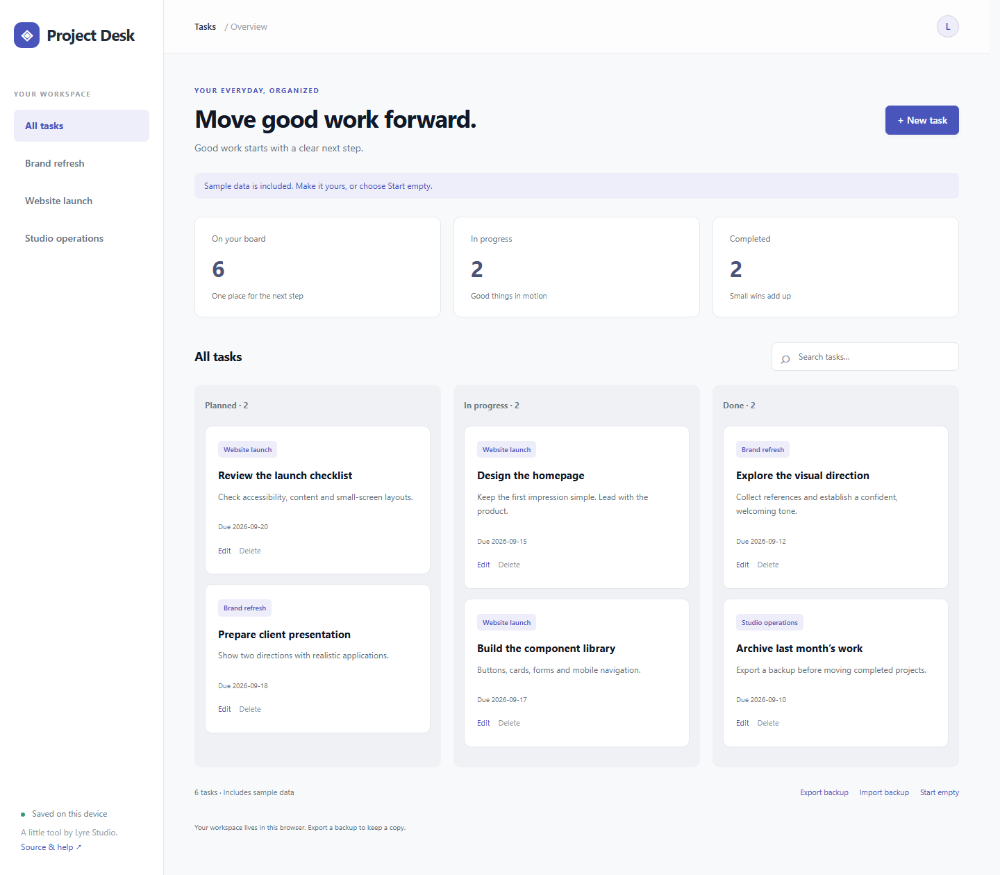

# Project Desk

A focused task board for freelancers and small project workflows.



## Use it

[Open the app](https://lyrestudio.github.io/project-desk/) · [Source](https://github.com/LyreStudio/project-desk)

Or clone this repository, install Node.js 22 or later, and run:

```sh
npm start
```

Open http://localhost:4173. No package installation, account or API key is required. PORT changes the port; HOST defaults to 127.0.0.1. To share a trusted local preview through Lyre, open this repository as a project and use its start script. This does not grant remote access by itself.

## What works

Create, edit and delete tasks; search and category filters; responsive desktop/phone layouts; browser-local persistence; validated JSON backup import and export. Start with clearly labeled sample data or choose **Start empty**. Import replaces this app's current data after confirmation. Export first if you want to keep it.

Data stays in this browser's localStorage on this origin. There is no cloud sync, multi-user collaboration, encryption-at-rest guarantee, account recovery or backup service. Other scripts on the same origin can access browser storage. Clearing site data removes it; keep exported backups. The application reports write failures and preserves the last saved state. Concurrent editing in separate tabs is not supported; reload before switching tabs.

## Checks

`npm test` runs the model/validation tests. Browser acceptance covers creation, editing, search, reload persistence, backup import/export, safe text rendering and deletion on desktop and narrow phone layouts. See VALIDATION.md for recorded results.

## Customize

Edit config.mjs for fields and sample content, app.css for the visual design, and app.mjs for interactions. Tabler 1.5.1 is vendored, so pages do not depend on a CDN. See TEMPLATE.md and vendor/ for provenance and notices.

## License

MIT. These standalone apps are open source; this license does not cover the separate Lyre desktop/phone product.
